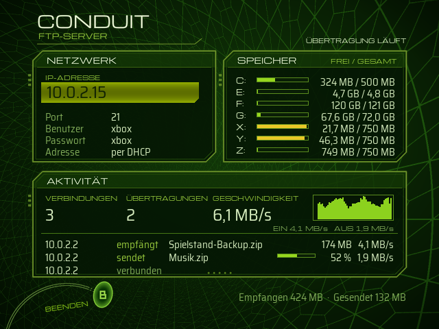
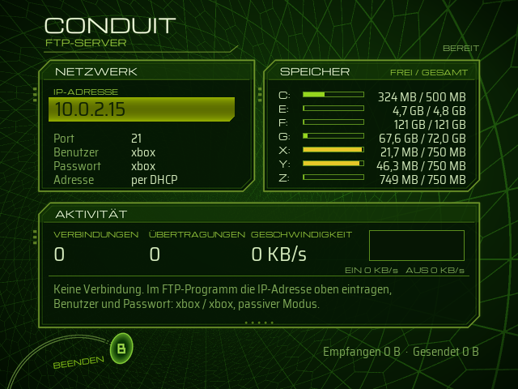

<p align="center">
  
</p>

<h1 align="center">Conduit</h1>

<h3 align="center">FTP Server für die Original-Xbox</h3>

<p align="center">
  Mit einer Statusanzeige im Stil des Original-Dashboards.<br>
  <a href="README.md">English version</a>
</p>

<p align="center">
  
</p>

<p align="center">
  
</p>

Conduit ist ein kleines Homebrew-Programm (gebaut mit [nxdk](https://github.com/XboxDev/nxdk)), das eine
modifizierte Xbox zum FTP-Server macht und anzeigt, was gerade passiert: die IP-Adresse zum Verbinden, freien
Speicher je Partition, aktive Verbindungen und Übertragungen sowie die aktuelle Geschwindigkeit.
Mit **B** auf dem Controller beendest du das Programm und kehrst zum Dashboard zurück.

> **Stand:** entwickelt und getestet im Emulator [xemu](https://xemu.app) (BIOS Cerbios 3.1.0 Beta).
> Auf echter Hardware an einer Konsole getestet: Statusanzeige, DHCP, Beenden und die FTP-Testsuite (siehe
> „Testen in xemu“) inklusive mehrerer gleichzeitiger Up- und Downloads. Feste IP und andere BIOS-Versionen sind nicht überprüft.
> Rückmeldungen und Pull Requests sind willkommen.

## Funktionen

- **Nur Statusanzeige, keine Menüs:** IP-Adresse, frei/gesamt mit Füllstandsbalken je Partition
  (C, E, F, G, X, Y, Z, soweit vorhanden), Verbindungen, Übertragungen, Geschwindigkeit (ein und aus getrennt)
  mit Verlaufsdiagramm sowie Dateiname, Fortschritt und Tempo je Verbindung.
- **Beenden per Controller:** `B` oder `BACK`. Läuft eine Übertragung, erscheint eine Warnung, und ein zweiter
  Druck innerhalb von 3 Sekunden beendet.
- **Vollwertiger FTP-Server:** passiver und aktiver Modus, Fortsetzen (`REST`), `MLSD`/`MLST`, bis zu 8
  gleichzeitige Verbindungen, Up- und Download parallel. Funktioniert mit FileZilla, WinSCP, `lftp`, Pythons `ftplib` u. a.
- **Eine virtuelle Wurzel:** `/C`, `/E`, `/F`, `/G`, `/X`, `/Y`, `/Z` entsprechen den Xbox-Laufwerken.
- Die Netzwerkeinstellungen kommen aus dem Dashboard (DHCP oder feste IP), auf der Xbox ist nichts einzustellen.
- **Netzwechsel im laufenden Betrieb:** Wird das Kabel gezogen, verschwindet die IP-Adresse aus der Anzeige
  („kein Kabel“). Wird es wieder eingesteckt, holt Conduit per DHCP eine neue Adresse, auch in einem anderen Netz
  oder VLAN, ohne Neustart. Verbindungen aus dem alten Netz werden automatisch freigegeben.
- Die Optik ahmt das Original-Dashboard nach (grüne Röhre, abgeschrägte Panels, glänzender Knopf). Alle Grafiken
  in diesem Repository sind selbst erstellt, es sind keine Microsoft-Dateien enthalten.
- **Nutzt die Textur deines Dashboards, wenn vorhanden:** Beim Start sucht Conduit die Original-Dashboard-Daten auf
  `C:` (`C:\xboxdashdata.*\default.xip`) und baut den Tunnel-Hintergrund aus dem dort gespeicherten Zellmuster.
  Fehlt das Dashboard oder sieht es anders aus, nimmt Conduit unbemerkt sein eigenes eingebautes Muster.
  Es wird nichts kopiert oder gespeichert; die Textur wird nur zur Laufzeit von der eigenen Konsole gelesen.

## Schnellstart

1. `default.xbe` (aus einem [Release](../../releases) oder selbst gebaut) in einen Ordner auf der Xbox kopieren,
   z. B. `E:\Apps\Conduit\default.xbe`, und über Dashboard oder Launcher starten.
2. Die angezeigte IP-Adresse notieren.
3. Vom PC verbinden:

   | | |
   |---|---|
   | Host | die angezeigte IP-Adresse |
   | Port | `21` |
   | Benutzer / Passwort | `xbox` / `xbox` |
   | Modus | passiv (Ports 50000-50099) empfohlen |

   ```sh
   lftp -u xbox,xbox 192.168.1.50
   ```

F: und G: gibt es nur, wenn das BIOS `Partition6` bzw. `Partition7` bereitstellt. Fehlende Partitionen werden
einfach nicht aufgelistet.

## Sicherheit

FTP ist unverschlüsselt, das Passwort geht im Klartext übers Netz. Conduit nur in einem vertrauenswürdigen
Netzwerk benutzen. Wer Port 21 erreicht und die Zugangsdaten kennt, kann alles auf allen Partitionen lesen,
überschreiben und löschen, auch die Systempartition C:.
Aktiver Modus (`PORT`/`EPRT`) ist nur zur IP-Adresse des eigenen Clients erlaubt (Schutz vor FTP-Bounce).
Hinter NAT funktioniert deshalb nur der passive Modus. Zugangsdaten vor dem Bauen in
[`src/shared.h`](src/shared.h) ändern (`FTP_USER`, `FTP_PASS`), falls der Standard nicht passt.

## Bauen

Voraussetzung sind die [nxdk-Abhängigkeiten](https://github.com/XboxDev/nxdk/wiki/Install-the-Prerequisites)
(clang, lld, llvm, bison, flex, cmake, make, git). Python 3 mit Pillow braucht man nur, um die Grafiken neu zu erzeugen.

```sh
git clone --recursive https://github.com/heinrichchristopher/Conduit.git     # nxdk liegt als Submodul in ./nxdk (fester, getesteter Stand)
cd Conduit
PATH=$PWD/nxdk/bin:$PATH make
# -> bin/default.xbe  und  Conduit.iso
```

Ohne `--recursive` geklont? Dann `git submodule update --init --recursive`. Ohne Submodul zeigt `NXDK_DIR` auf ein
vorhandenes nxdk: `make NXDK_DIR=/pfad/zu/nxdk`. Das Submodul legt den nxdk-Stand fest, mit dem Conduit getestet
wurde; nxdk selbst wird unverändert verwendet.

lwIP erlaubt in nxdk standardmäßig nur 4 Sockets, viel zu wenig für einen FTP-Server. Das Makefile erhöht die
Grenze (`MEMP_NUM_NETCONN=40`), schaltet Socket-Timeouts ein (`LWIP_SO_SNDTIMEO`, `LWIP_SO_RCVTIMEO`, damit
eine abgebrochene Verbindung die Sitzung nicht blockiert) und die Adressprüfung bei DHCP ab
(`LWIP_DHCP_DOES_ACD_CHECK=0`). Außerdem bekommt der Netzwerktreiber 256 statt 64 Empfangspuffer
(`RX_BUFF_CNT=256`), und Pakete außer der Reihe dürfen je Verbindung höchstens 8 davon belegen
(`TCP_OOSEQ_MAX_PBUFS=8`); sonst blieben mehrere gleichzeitige Uploads hängen. Dafür wird lwIP einmalig im nxdk-Ordner neu gebaut (ohne die Debug-Ausgaben von lwIP, siehe `src/lwip_tune.h`); die Stempeldatei
`nxdk/lib/net/.netdefs` hält die Einstellungen fest und löst bei Änderungen einen neuen Build aus.

Grafiken neu erzeugen (nur nach Änderungen an der Optik; die Ergebnisse liegen eingecheckt in `src/gen_*`):

```sh
python3 tools/make_assets.py    # Panel-Overlay + Ersatz-Zellmuster -> assets/, src/gen_assets.c, src/gen_layout.h
python3 tools/make_logo.py      # Logo + Social-Preview -> assets/logo/
```

Der Tunnel selbst wird beim Start auf der Xbox berechnet (`src/tunnel.c`, dauert etwa so lange wie ein Startbild);
`tools/make_assets.py --tunnel` rendert dasselbe Bild als Referenz am PC (`assets/tunnel.png`).

Die Oberfläche ist derzeit auf Deutsch. Alle Texte stehen in `src/main.c` und die fest eingezeichneten
Beschriftungen in `tools/make_assets.py`.

## Testen in xemu

```sh
# 1. tools/xemu-nat.toml.example in die eigene xemu-Konfiguration übernehmen
#    (leitet Host 2121 -> Xbox 21 und die passiven Ports weiter)
# 2. starten
XEMU_CONFIG=~/meine-xemu.toml tools/xemu_ftp.sh Conduit.iso
# 3. mit 127.0.0.1, Port 2121 verbinden
lftp -p 2121 -u xbox,xbox 127.0.0.1
```

Dort geprüft: Anmeldung (falsches Passwort wird abgelehnt), Verzeichnislisten (`LIST`, `NLST`, `MLSD`, `MLST`),
`CWD` inkl. `..` und ungültiger Laufwerke, Up- und Download von 20 MB mit identischem Inhalt, `REST`, `APPE`,
Umbenennen, Löschen, `MKD`/`RMD` sowie 150 MB Upload parallel zu 80 MB Download mit passender Prüfsumme
(10-13 MB/s im Emulator). Außerdem: Kabel ab/an (per QMP `set_link`) mit neuer DHCP-Adresse, Kabel ab während
eines Downloads (Verbindung wird freigegeben), `STOR` ohne `PASV` lässt die vorhandene Datei unverändert,
zu lange Pfade und Befehlszeilen werden abgelehnt, `PORT` zu fremden Adressen wird abgewiesen. Dateigrößen um
Sektor- und Puffergrenzen (0, 1, 511, 512, 513 Bytes, 128 KB ± 1 usw.), Fortsetzen an krummen Positionen, `APPE`,
vier gleichzeitige Uploads sowie zwei Uploads parallel zu zwei Downloads mit identischem Inhalt. Fortsetzen (`REST`)
genau auf Sektorgrenzen über einer längeren Altdatei, `REST` hinter dem Dateiende wird mit `554` abgelehnt, `ABOR`
während eines Downloads, die 9. Verbindung wird mit `421` abgewiesen.

Auf der echten Konsole lief dieselbe Testsuite fehlerfrei, ebenso drei Uploads parallel zu zwei Downloads (auch direkt
nach einem `ABOR`). Ältere Builds ohne die Puffereinstellungen im Makefile blieben dort bei mehreren gleichzeitigen
Uploads hängen. Geschwindigkeit an der Konsole (100-MBit-Netz, 200-MB-Dateien nach F:): je etwa 11,1 MB/s für
Up- und Download, also die volle Leitung, auch auf drei parallele Übertragungen verteilt; Up- und Download
gleichzeitig zusammen etwa 19 MB/s (8,9 hoch, 10,3 runter).
Viele kleine Dateien wie bei einer entpackten Spiel-Disk (2000 Dateien mit zusammen 29 MB in 41 Ordnern, eine
Verbindung): etwa 190-210 Dateien/s hoch und 200-230 Dateien/s runter. Mehrere gleichzeitige Verbindungen sind
dabei nicht schneller. Gemischt (1503 Dateien, 729 MB): etwa 9,8 MB/s hoch und 9,5 MB/s runter. Weil jede Datei
eine eigene Datenverbindung braucht, lässt lwIP abgebaute Verbindungen nur kurz nachwirken (`TCP_MSL`) und darf
passive Ports sofort wieder belegen (`SO_REUSE`, siehe Makefile). Ohne das gingen nach einigen hundert Dateien die
Ports aus (`425`), und einzelne Verbindungsaufbauten hingen 60 s.
In xemu verzögert die NAT-Schicht gleichzeitige Verbindungsaufbauten gelegentlich um Sekunden; das
liegt am Emulator.

## Unterstützte FTP-Befehle

`USER PASS SYST FEAT OPTS CLNT PWD CWD CDUP TYPE MODE STRU PASV EPSV PORT EPRT LIST NLST MLSD MLST RETR STOR APPE
REST DELE MKD RMD RNFR RNTO SIZE MDTM NOOP QUIT ABOR ALLO HELP STAT` (plus die alten `X`-Varianten).

## Grenzen

- Echte Hardware: nur an einer Konsole getestet (siehe Hinweis oben).
- Kein TLS, ein fester Benutzer, nur IPv4.
- Dateinamen werden als Bytes durchgereicht; FATX erlaubt 42 Zeichen und nur einen eingeschränkten Zeichensatz.
- Zeitstempel werden so gemeldet, wie der Kernel sie liefert (UTC).
- Oberfläche nur auf Deutsch.

## Projektaufbau

```
src/main.c        Statusanzeige, Controller-Eingabe, Laufwerke und Netzwerk
src/ftpd.c        FTP-Server (ein Thread je Verbindung)
src/shared.h      gemeinsamer Zustand, Zugangsdaten, Ports
src/tunnel.c      berechnet den Tunnel-Hintergrund beim Start
src/dashassets.c  liest optional das Zellmuster aus dem Original-Dashboard auf C: (XIP/XBX)
src/lwip_tune.h   lwIP-Einstellungen, die nxdks lwipopts.h sonst überschreiben würde
src/gen_*         erzeugte Grafiken (zlib-gepackte Pixel und Schriften), siehe tools/make_assets.py
assets/           Overlay, Ersatz-Zellmuster, Schriften (mit Lizenzen), Logo
tools/            Grafik-Generatoren, xemu-Hilfsskript
```

## Lizenz

Conduit steht unter der [MIT-Lizenz](LICENSE). Die gebaute Datei enthält nxdk, lwIP, SDL2, FreeType und weitere
Bibliotheken, siehe [THIRD_PARTY_NOTICES.md](THIRD_PARTY_NOTICES.md). Die eingebetteten Schriften (Michroma,
Saira Semi Condensed) stehen unter der SIL Open Font License 1.1, die Lizenztexte liegen in `assets/fonts/`.

„Xbox" ist eine Marke der Microsoft Corporation. Dieses Projekt steht in keiner Verbindung zu Microsoft und wird
nicht von Microsoft unterstützt.
