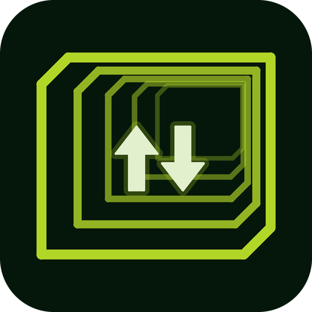
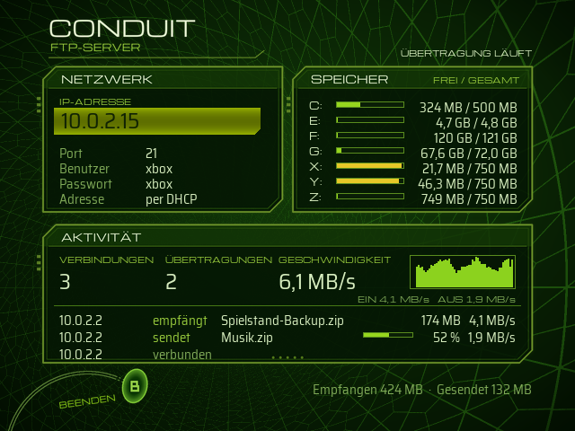
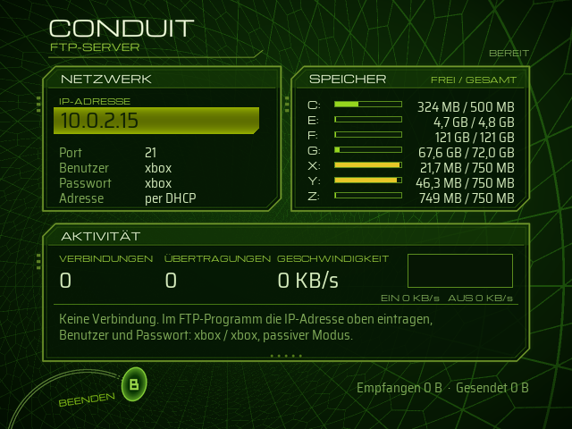

<p align="center">
  
</p>

<h1 align="center">Conduit</h1>

<h3 align="center">FTP Server for the original Xbox</h3>

<p align="center">
  With a status screen in the style of the stock dashboard.<br>
  <a href="README.de.md">Deutsche Version</a>
</p>

<p align="center">
  
</p>

<p align="center">
  
</p>

Conduit is a small homebrew app (built with [nxdk](https://github.com/XboxDev/nxdk)) that turns a modded Xbox into
an FTP server and shows what is going on: the IP address to connect to, free space per partition, active
connections and transfers, and the current speed. Press **B** on the controller to quit back to the dashboard.

> **Status:** developed and tested in the [xemu](https://xemu.app) emulator (Cerbios 3.1.0 Beta BIOS).
> On real hardware it has been tested on one console: status screen, DHCP, quitting and the FTP test suite (see
> "Testing in xemu"), including several simultaneous uploads and downloads. Static IP and other BIOSes have not been verified.
> Reports and pull requests are welcome.

## Features

- **Status screen only, no menus:** IP address, free/total space with a fill bar per partition
  (C, E, F, G, X, Y, Z, whatever exists), connections, transfers, live speed (in and out separately) with a
  short history graph, and per-connection file name, progress and speed.
- **Quit with the controller:** `B` or `BACK`. If a transfer is running, a warning appears and a second press
  within 3 seconds is required.
- **Full-featured FTP server:** passive and active mode, resume (`REST`), `MLSD`/`MLST`, up to 8 simultaneous
  connections, uploads and downloads in parallel. Works with FileZilla, WinSCP, `lftp`, Python's `ftplib`, ...
- **One virtual root:** `/C`, `/E`, `/F`, `/G`, `/X`, `/Y`, `/Z` map to the Xbox drives.
- Network settings come from the dashboard (DHCP or static IP). Nothing to configure on the Xbox.
- **Network changes while running:** unplugging the cable clears the IP address on screen ("kein Kabel").
  After plugging it back in, Conduit requests a fresh address via DHCP, even on a different network or VLAN,
  without a restart. Connections from the old network are released automatically.
- Look and feel imitate the original dashboard (green tunnel, chamfered panels, glossy button). All artwork in
  this repository is original; no Microsoft assets are included.
- **Uses your dashboard's own texture if present:** at startup Conduit looks for the original dashboard data on
  `C:` (`C:\xboxdashdata.*\default.xip`) and builds the tunnel background from the cell pattern stored there.
  If the dashboard is missing or looks different, it silently falls back to its own built-in pattern.
  Nothing is copied or stored; the texture is only read from your own console while the program runs.

## Quick start

1. Copy `default.xbe` (from a [release](../../releases) or your own build) to a folder on your Xbox,
   e.g. `E:\Apps\Conduit\default.xbe`, and start it from your dashboard/launcher.
2. Note the IP address on screen.
3. Connect from your PC:

   | | |
   |---|---|
   | Host | the IP shown on screen |
   | Port | `21` |
   | User / password | `xbox` / `xbox` |
   | Mode | passive (ports 50000-50099) recommended |

   ```sh
   lftp -u xbox,xbox 192.168.1.50
   ```

Partitions F: and G: are only present if your BIOS provides `Partition6` / `Partition7`. Missing partitions are
simply not listed.

## Security

FTP is unencrypted and the password is sent in clear text. Use Conduit only on a network you trust.
Anyone who can reach port 21 and knows the credentials can read, overwrite and delete everything on all
partitions, including the system partition C:.
Active mode (`PORT`/`EPRT`) may only target the client's own IP address (FTP bounce protection), so behind NAT
only passive mode works. Change the credentials in [`src/shared.h`](src/shared.h)
(`FTP_USER`, `FTP_PASS`) before building if the default is not acceptable.

## Building

Requirements: the [nxdk prerequisites](https://github.com/XboxDev/nxdk/wiki/Install-the-Prerequisites)
(clang, lld, llvm, bison, flex, cmake, make, git). Python 3 with Pillow is only needed to regenerate the artwork.

```sh
git clone --recursive https://github.com/heinrichchristopher/Conduit.git     # nxdk is a submodule in ./nxdk (pinned, tested revision)
cd Conduit
PATH=$PWD/nxdk/bin:$PATH make
# -> bin/default.xbe  and  Conduit.iso
```

Already cloned without `--recursive`? Run `git submodule update --init --recursive`. Without the submodule, point
`NXDK_DIR` at an existing nxdk checkout: `make NXDK_DIR=/path/to/nxdk`. The submodule pins the nxdk revision Conduit
was tested with; nxdk itself is used unmodified.

lwIP in nxdk only allows 4 sockets by default, far too few for an FTP server. The Makefile raises the limit
(`MEMP_NUM_NETCONN=40`), enables socket timeouts (`LWIP_SO_SNDTIMEO`, `LWIP_SO_RCVTIMEO`, so a dropped client
cannot block its session) and disables the DHCP address conflict check (`LWIP_DHCP_DOES_ACD_CHECK=0`). The NIC driver also gets 256 instead of 64 receive buffers (`RX_BUFF_CNT=256`), and
out-of-order segments may hold at most 8 of them per connection (`TCP_OOSEQ_MAX_PBUFS=8`); otherwise several uploads at
once could stall. lwIP is
rebuilt once inside the nxdk tree for this (with lwIP's debug output compiled out, see `src/lwip_tune.h`); a stamp file `nxdk/lib/net/.netdefs` records the settings and
triggers a rebuild when they change.

Regenerate the artwork (only after changing the look; the results are committed in `src/gen_*`):

```sh
python3 tools/make_assets.py    # panels overlay + fallback cell pattern -> assets/, src/gen_assets.c, src/gen_layout.h
python3 tools/make_logo.py      # logo + social preview -> assets/logo/
```

The tunnel itself is rendered on the Xbox at startup (`src/tunnel.c`, about as long as a splash screen);
`tools/make_assets.py --tunnel` renders the same picture on the PC as a reference (`assets/tunnel.png`).

The UI text is German at the moment. All strings are in `src/main.c` and the labels baked into
`tools/make_assets.py`.

## Testing in xemu

```sh
# 1. add tools/xemu-nat.toml.example to your xemu config (forwards host 2121 -> Xbox 21 and the passive ports)
# 2. start
XEMU_CONFIG=~/my-xemu.toml tools/xemu_ftp.sh Conduit.iso
# 3. connect to 127.0.0.1, port 2121
lftp -p 2121 -u xbox,xbox 127.0.0.1
```

What has been verified there: login (wrong password is rejected), directory listings (`LIST`, `NLST`, `MLSD`,
`MLST`), `CWD` including `..` and invalid drives, upload and download of 20 MB with identical content, `REST`,
`APPE`, rename, delete, `MKD`/`RMD`, and a 150 MB upload parallel to an 80 MB download with matching checksum
(10-13 MB/s in the emulator). Also: cable unplug/replug (via QMP `set_link`) with a new DHCP address, unplugging
during a download (the connection is released), `STOR` without `PASV` leaves an existing file untouched,
overlong paths and command lines are rejected, `PORT` to foreign addresses is refused. File sizes around sector and
buffer boundaries (0, 1, 511, 512, 513 bytes, 128 KB ± 1, ...), resuming at odd offsets, `APPE`, four simultaneous
uploads, and two uploads parallel to two downloads with identical content. Resuming (`REST`) exactly on sector
boundaries over a longer existing file, `REST` past the end of the file is rejected with `554`, `ABOR` during a
download, the 9th connection is refused with `421`.

On the real console the same test suite passed, as did three uploads parallel to two downloads (also right after an
`ABOR`). Older builds without the buffer settings in the Makefile stalled there with several simultaneous uploads. Speed on the console (100 Mbit network, 200 MB files to F:): about
11.1 MB/s each for upload and download, i.e. the full line rate, also when split across three parallel transfers;
upload and download at the same time together about 19 MB/s (8.9 up, 10.3 down).
Many small files like an extracted game disc (2000 files totalling 29 MB in 41 folders, one connection): about
190-210 files/s up and 200-230 files/s down. Several simultaneous connections are not faster here. Mixed (1503
files, 729 MB): about 9.8 MB/s up and 9.5 MB/s down. Since every file needs its own data connection, lwIP keeps
closed connections around only briefly (`TCP_MSL`) and may reuse passive ports immediately (`SO_REUSE`, see the
Makefile). Without this the ports ran out after a few hundred files (`425`) and single connection setups hung for 60 s.
In xemu the NAT layer occasionally delays simultaneous connection setups by seconds; that is the emulator.

## Supported FTP commands

`USER PASS SYST FEAT OPTS CLNT PWD CWD CDUP TYPE MODE STRU PASV EPSV PORT EPRT LIST NLST MLSD MLST RETR STOR APPE
REST DELE MKD RMD RNFR RNTO SIZE MDTM NOOP QUIT ABOR ALLO HELP STAT` (plus the legacy `X`-prefixed variants).

## Limitations

- Real hardware: tested on one console only (see the status note above).
- No TLS, single fixed account, IPv4 only.
- File names are passed through as bytes; FATX allows 42 characters and a limited character set.
- Timestamps are reported as the kernel returns them (UTC).
- UI is German only.

## Project layout

```
src/main.c        status screen, controller input, drive/network setup
src/ftpd.c        FTP server (one thread per connection)
src/shared.h      shared state, credentials, ports
src/tunnel.c      renders the tunnel background at startup
src/dashassets.c  reads the cell texture from the original dashboard on C: (XIP/XBX), optional
src/lwip_tune.h   lwIP settings that nxdk's lwipopts.h would otherwise override
src/gen_*         generated artwork (zlib-packed pixels and fonts), see tools/make_assets.py
assets/           overlay, fallback cell pattern, fonts (with licenses), logo
tools/            artwork generators, xemu helper
```

## License

Conduit is released under the [MIT License](LICENSE). The built binary contains nxdk, lwIP, SDL2, FreeType and
others, see [THIRD_PARTY_NOTICES.md](THIRD_PARTY_NOTICES.md). The embedded fonts (Michroma, Saira Semi Condensed)
are under the SIL Open Font License 1.1; their license texts are in `assets/fonts/`.

"Xbox" is a trademark of Microsoft Corporation. This project is not affiliated with or endorsed by Microsoft.
